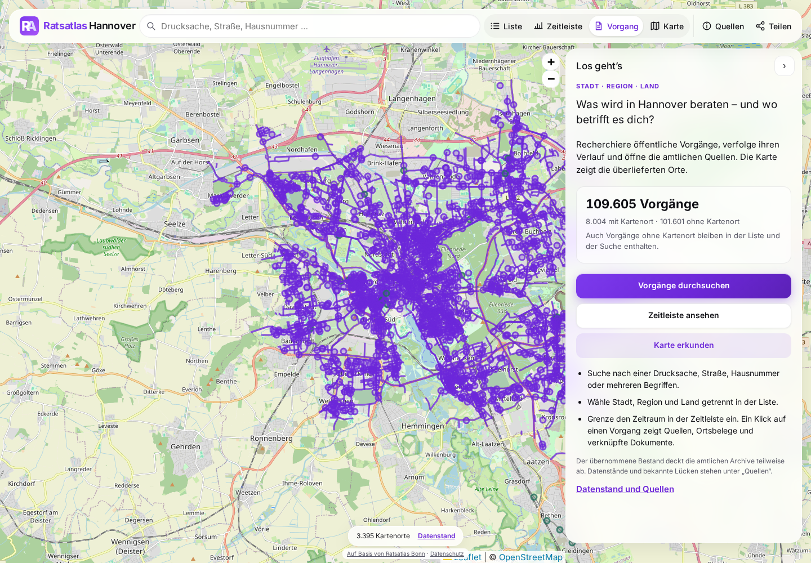
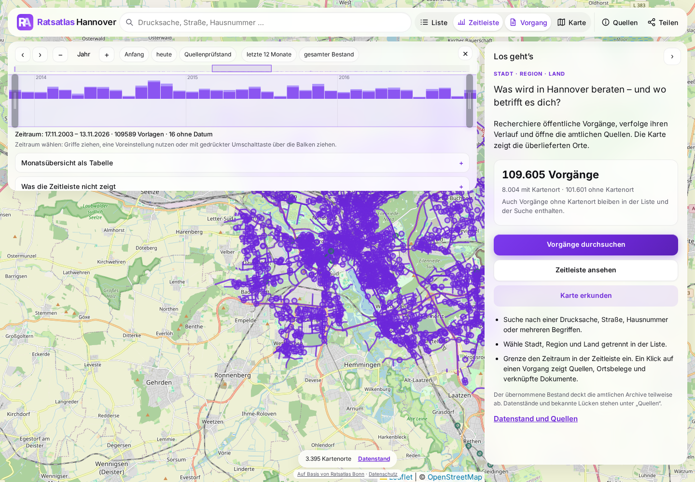
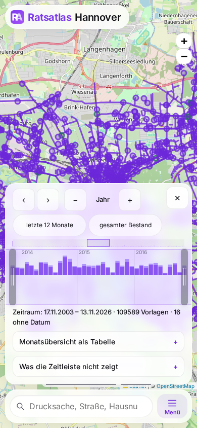

# Prüfung der Hannover-Anwendung

## Bonn-Integration — 21. November 2026

Die Anwendung mit den übernommenen Bonner Komponenten wurde mit dem
vollständigen Hannover-Datenpaket geprüft. Der
[erfolgreiche CI-Lauf 44885374971](https://github.com/carstenartur/ratsatlas-Hannover/actions/runs/44885374971)
gehört zu Commit
[`8967108b089a23cf76837cdbc8d0163735d959e7`](https://github.com/carstenartur/ratsatlas-Hannover/commit/8967108b089a23cf76837cdbc8d0163735d959e7).
Die beiden Browserberichte und alle 22 nachfolgend verlinkten Bildschirmbilder
stammen aus diesem Lauf und sind dauerhaft im Repository enthalten.

### Ergebnis

| Prüfung | Ergebnis |
|---|---|
| JavaScript | 34 Tests bestanden, einschließlich Datum, undatierter Vorgänge, Zeitleistenadapter und alter/neuer URLs |
| Import | 19 Python-Tests bestanden |
| Vollständiger Datenbestand | Archiv aus vier Teilen rekonstruiert und Offline-Integritätsprüfung bestanden |
| Chromium | Vollständiger Ablauf mit 13 dokumentierten Prüfpunkten und fünf gezielten Interaktionsfällen bestanden |
| WebKit | Derselbe vollständige Ablauf und dieselben fünf Interaktionsfälle bestanden |
| Laufzeit | In beiden Berichten keine JavaScript-, Konsolen-, Netzwerk- oder lokalen Assetfehler |
| Darstellung | Desktop 1440 × 1000, Tablet 820 × 1180 und Telefon 390 × 844; ohne horizontales Überlaufen |
| Sichtprüfung | Alle 22 Bilder angesehen; mobile Ansichten, Tablet und Quellen zusätzlich unabhängig geprüft |

[Chromium-Bericht](qa/2026-11-21-bonn/chromium/report.json) ·
[WebKit-Bericht](qa/2026-11-21-bonn/webkit/report.json)

### Geprüftes Verhalten

- Vollflächige Karte, Bonner Navigation und einklappbare Fenster laden alle
  **109.605 Vorgänge**, darunter **8.004 mit Kartenort**, sowie **3.395 Originalgeometrien**.
  **101.601 Vorgänge ohne Kartenort** bleiben recherchierbar. Quellpaket,
  Datenableitungen und Importverfahren blieben gegenüber dem ersten Import unverändert.
- Anfrage und Antwort **1047/2026** bleiben getrennt, intern verknüpft und über
  Zurück/Vorwärts wiederherstellbar. Die gleichlautende Nummer **0098/2004**
  öffnet Stadt- und Regionsvorgänge mit unterschiedlichen Originalkennungen.
- Alle **15 Landtagsvorgänge** einschließlich Originalkennung und geteiltem
  Quellenfilter werden geladen. Alte Karten-/Vorgangslinks und reine Suchlinks funktionieren weiter.
- Die Suche nach **Gustav-Adolf-Straße** zeigt den Originalbeleg und einen
  anklickbaren Punkt. Der Linienvorgang **15-0071/2025** und die Fläche zum
  Vorgang **15-1035/2016** werden mit ihren Originalgeometrien fokussiert und
  unter der Auswahlhervorhebung angeklickt; das Popup enthält den richtigen Vorgang.
- Die Bonner Zeitleiste filtert mit ISO-Datumsgrenzen. Sofortiges Teilen und
  Fensterwechsel erhalten den gewählten Zeitraum. Zurücksetzen stellt den
  gesamten Bestand einschließlich **16 undatierter Vorgänge** wieder her.
- Langsam geladene Vorgänge stehlen den Suchfokus nicht. Datenabhängige
  Zeitleistensteuerung ist während des Ladens gesperrt. Auf dem Telefon
  sind Zeitvorgaben und Zurücksetzen sichtbar und bedienbar.
- Bei maximaler Seitenfensterbreite bleibt auf einem 1280 × 900 großen
  Bildschirm ausreichend Platz für die Zeitleiste. Auf Tablet und Telefon
  ist jeweils genau das erwartete Fenster geöffnet; die freie Karte hat kein
  offenes Fenster oder Menü.

### Review und Aufnahmeverfahren

Eine unabhängige Prüfung des gesamten Branches fand sechs relevante
Interaktionsfehler. Zwei gezielte Tests belegten die falsch behandelten
Datumsgrenzen; die Browser reproduzierten die fünf übrigen Fehler vor deren
Korrektur. Die korrigierten Fälle bestehen in beiden Engines.

Die erste Sichtprüfung erkannte außerdem Aufnahmen während eines
Fensterwechsels. Die endgültige Aufnahme wartet deshalb auf Schrift,
Übergänge, Kartenbilder und fertige Darstellung. Sie wählt Liste, freie Karte
und Zeitleiste ausdrücklich, prüft den geschlossenen Menüstatus und verwirft
identische Bilder dieser drei verschiedenen Mobilansichten.

In den Headless-WebKit-Aufnahmen scheint die Karte schärfer durch die
Glasflächen als in Chromium. Leere native Datumsfelder unterscheiden sich
ebenfalls in der Darstellung. Beschriftungen, Bestandszahlen und
Hauptbedienelemente bleiben in den geprüften Ansichten lesbar und erreichbar.

### Bildschirmbilder beider Engines

| Ansicht | Chromium | WebKit |
|---|---|---|
| Einstieg | [Desktop](qa/2026-11-21-bonn/chromium/desktop.png) | [Desktop](qa/2026-11-21-bonn/webkit/desktop.png) |
| Anfrage und Antwort | [Details](qa/2026-11-21-bonn/chromium/request-answer.png) | [Details](qa/2026-11-21-bonn/webkit/request-answer.png) |
| Ortsbeleg | [Gustav-Adolf-Straße](qa/2026-11-21-bonn/chromium/location-evidence.png) | [Gustav-Adolf-Straße](qa/2026-11-21-bonn/webkit/location-evidence.png) |
| Originale Linie | [Greifswalder Straße](qa/2026-11-21-bonn/chromium/geometry-line.png) | [Greifswalder Straße](qa/2026-11-21-bonn/webkit/geometry-line.png) |
| Originale Fläche | [Ihmevisionen](qa/2026-11-21-bonn/chromium/geometry-polygon.png) | [Ihmevisionen](qa/2026-11-21-bonn/webkit/geometry-polygon.png) |
| Zeitleiste | [Desktop](qa/2026-11-21-bonn/chromium/timeline.png) | [Desktop](qa/2026-11-21-bonn/webkit/timeline.png) |
| Tablet | [Liste](qa/2026-11-21-bonn/chromium/tablet.png) | [Liste](qa/2026-11-21-bonn/webkit/tablet.png) |
| Telefon: Liste | [Liste](qa/2026-11-21-bonn/chromium/mobile-list.png) | [Liste](qa/2026-11-21-bonn/webkit/mobile-list.png) |
| Telefon: Karte | [Freie Karte](qa/2026-11-21-bonn/chromium/mobile-map.png) | [Freie Karte](qa/2026-11-21-bonn/webkit/mobile-map.png) |
| Telefon: Zeitleiste | [Zeitleiste](qa/2026-11-21-bonn/chromium/mobile-timeline.png) | [Zeitleiste](qa/2026-11-21-bonn/webkit/mobile-timeline.png) |
| Quellen und Datenstand | [Quellen](qa/2026-11-21-bonn/chromium/sources.png) | [Quellen](qa/2026-11-21-bonn/webkit/sources.png) |

### Veröffentlichung und Grenzen

Der oben genannte Lauf prüft die Anwendung unter dem tatsächlichen
Projektunterpfad `/ratsatlas-Hannover/`. Merge, Veröffentlichung und die
anschließende Kontrolle der Live-Seite werden in
[PR #2](https://github.com/carstenartur/ratsatlas-Hannover/pull/2) und den
[Pages-Läufen auf main](https://github.com/carstenartur/ratsatlas-Hannover/actions/workflows/veroeffentlichen.yml?query=branch%3Amain)
nachgewiesen. Nur ein erfolgreicher Push-Lauf auf main veröffentlicht die Seite.

Die Prüfung belegt die Anwendung und den übernommenen Datenstand. Sie
ersetzt keine Vollständigkeitsprüfung der amtlichen Archive. Die bekannten
Erfassungslücken und unterschiedlichen Quellenstände bleiben in der
Anwendung und in [DATEN.md](DATEN.md) dokumentiert.

## Nachprüfung des öffentlichen Deployments

Der erste Live-Aufruf nach dem Bonn-Deployment zeigte eine gemischte
Cache-Version: Die neue HTML-Seite wurde mit der alten `app.js` ausgeführt.
Der Fehler `Cannot set properties of null (setting 'oninput')` an Zeile 298
gehörte zum alten Suchfeld `query`; die neue Seite verwendet `q`.
Daraufhin erhalten HTML-Verweise, Modulimporte und Such-Worker eine gemeinsame
Versionskennung. Ein zusätzlicher Browser-Prüfpunkt erfasst alle zehn
betroffenen Runtime-Dateien einschließlich Worker-Anfragen und verlangt eine
einheitliche, nicht leere Version. Der abschließende CI- und Live-Nachweis
wird im zugehörigen Korrektur-PR festgehalten; die fachliche Oberfläche und
der Datenbestand der oben dokumentierten Bilder bleiben gleich.

## Historischer Nachweis

Der [Prüfbericht des ersten Hannover-Imports](qa/2026-11-21/README.md)
mit den damaligen Chromium-Bildern bleibt erhalten. Er bezieht sich auf die
vorherige Oberfläche, 18 JavaScript-Tests und 19 Python-Tests.
