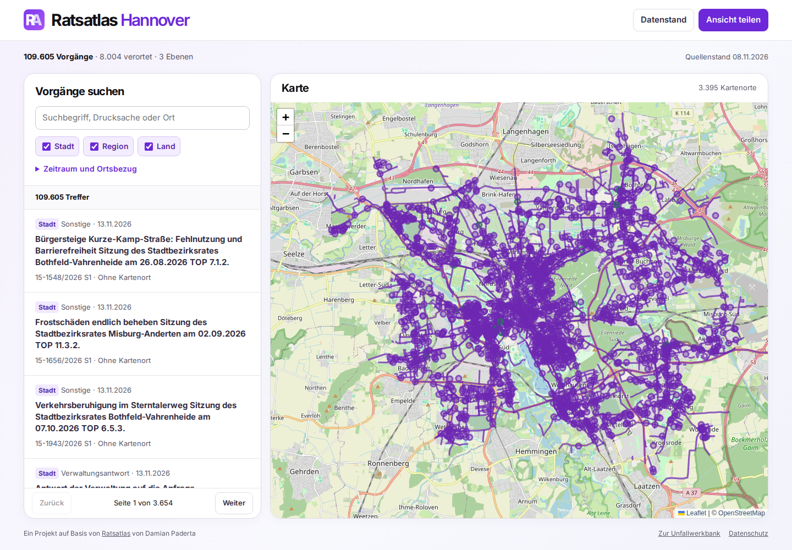
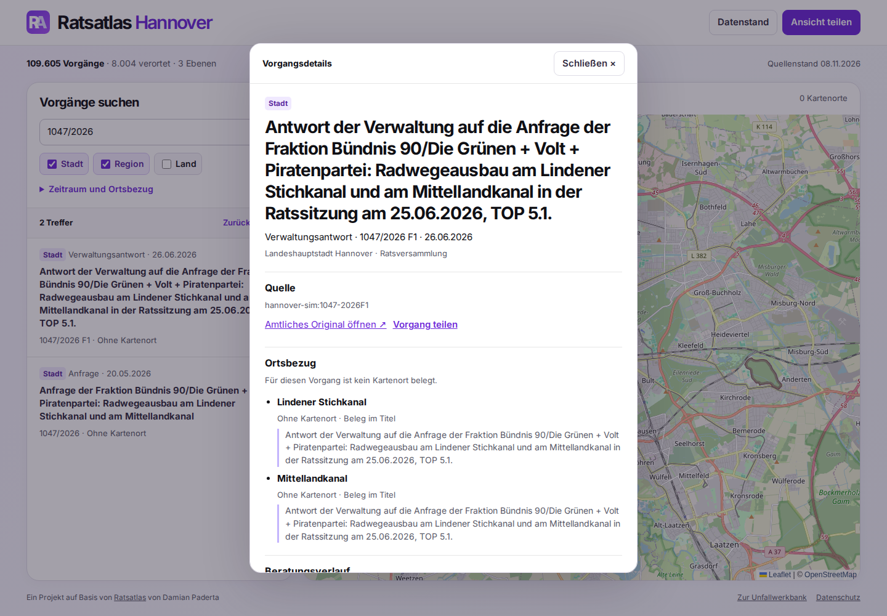
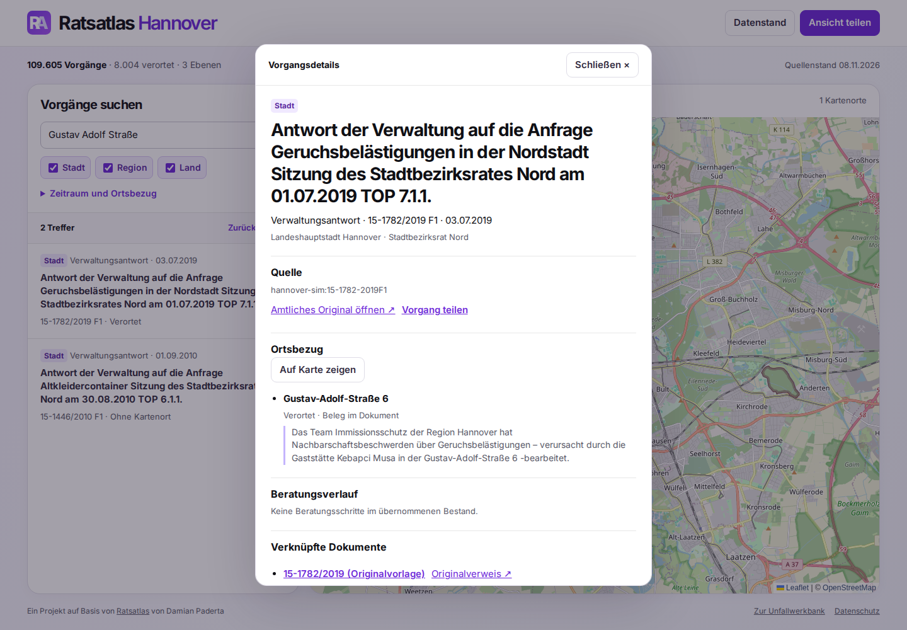
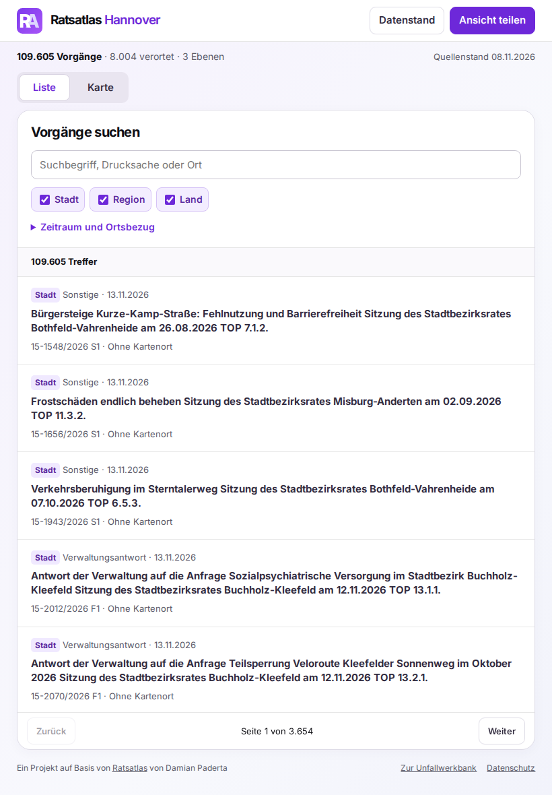
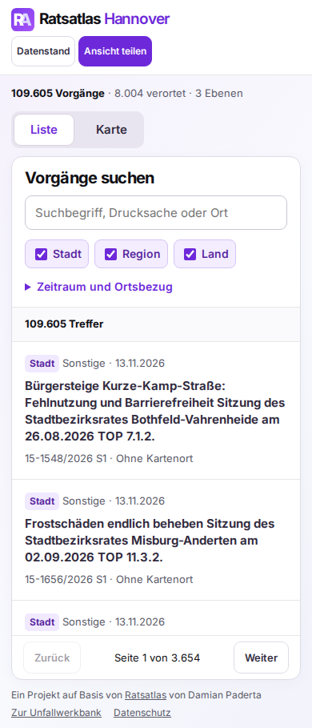
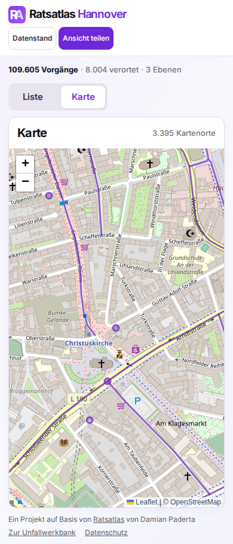
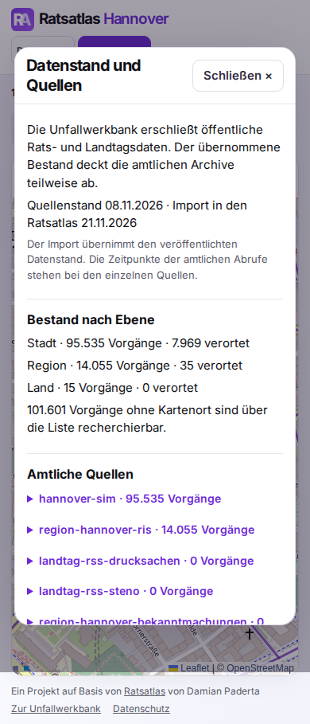

# Erster Hannover-Import — Prüfung am 21. November 2026

Am 21. November 2026 wurde die Anwendung mit dem vollständigen übernommenen
Datenpaket geprüft. Der [erfolgreiche CI-Lauf](https://github.com/carstenartur/ratsatlas-Hannover/actions/runs/44876266802)
bezieht sich auf Commit `fcb9446fb251a9826dc769f4a087f2eaf6ec7a12`.
Die Bildschirmbilder und der maschinenlesbare Bericht sind unten dauerhaft
im Repository enthalten; spätere Prüfläufe erzeugen zusätzlich eigene Artefakte.

## Ergebnis

- 18 JavaScript-Tests und 19 Python-Tests bestanden.
- Vollständige Rekonstruktion des Datenarchivs aus vier Teilen und anschließende Offline-Integritätsprüfung bestanden.
- 109.605 Vorgänge, 8.004 verortete Vorgänge und 3.395 Originalgeometrien in der Browseranwendung geladen.
- Anfrage und Antwort 1047/2026 getrennt gefunden, Originalquelle angezeigt und interne Verknüpfung geöffnet.
- Beleg zur Gustav-Adolf-Straße gefunden, Karte fokussiert und hervorgehobenen Ort angeklickt.
- Filterwechsel schließt das Popup; schnelle Such- und Ebenenwechsel erhalten die Eingabe.
- Alle 15 Landtagsvorgänge einschließlich Originalkennungen und geteilten Filter-URLs geprüft.
- Desktop (1440 × 1000), Tablet (820 × 1180) und Telefon (390 × 844) ohne horizontales Überlaufen geprüft.
- Keine JavaScript-Fehler, Konsolenfehler oder fehlgeschlagenen Netzwerkanfragen im erfolgreichen Browserlauf.

Die automatisierten Tests verwenden Chromium. Die Bildschirmbilder wurden
anschließend visuell kontrolliert. Diese Prüfung belegt die Anwendung und
den übernommenen Datenstand; sie ersetzt keine Vollständigkeitsprüfung der
amtlichen Archive. Ein Live-Deployment wird separat nach dem Merge geprüft.

[Maschinenlesbarer Browserbericht](report.json)

## Desktop

## Details und Belege

## Tablet

## Smartphone

